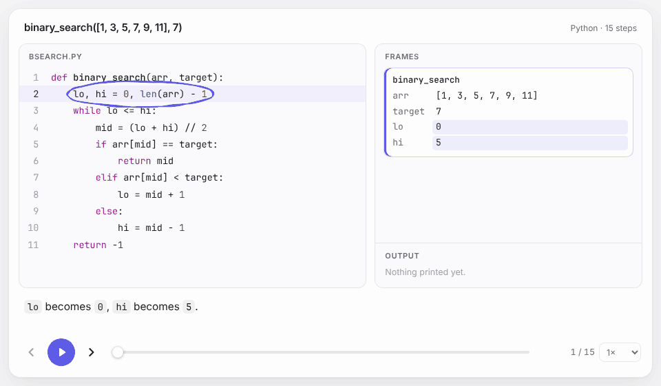

<h1 align="center">visset</h1>

<p align="center"><b>See what your code does, one step at a time.</b><br>
A tutor's walkthrough for any Python function: the exact expression circled, the state beside it, a sentence that explains it.</p>

<p align="center">
  <a href="https://github.com/nur0078/visset/actions/workflows/ci.yml"></a>
  
  <a href="LICENSE"></a>
</p>

<p align="center"></p>

```python
import visset

visset.show(binary_search, [1, 3, 5, 7, 9, 11], 7)   # like plt.show(), for code
```

In Jupyter, JupyterLab, VS Code or Colab, the walkthrough plays right under the cell.

## Why visset

- **It points at the exact code.** Not the line: the expression. `arr[mid] == target`, `left += 1`, the condition of a `while`. Marks are hand-drawn, so they read like a teacher's pen.
- **It explains in plain English.** "`lo <= hi` is true, so the loop body runs." "`arr[3]` becomes `9`." No AI needed.
- **It shows only what you ask for.** One function, part of a function, or a snippet, with real line numbers. Not a whole program.
- **It's one HTML file.** Works offline. Drop it into a course page, a blog post or your docs.
- **It's fast and light.** About 0.2 s from command to walkthrough. No runtime dependencies.

## Try it

```bash
visset run search.py --fn binary_search --args "[1, 3, 5, 7], 5"   # one function call
visset run search.py --lines 4-9                                   # part of a function
visset run snippet.py --given "arr=[1, 3, 5], target=3"            # a fragment with inputs
```

```python
visset.show(snippet, given={"arr": [1, 3, 5], "target": 3})
visset.to_html(visset.trace(binary_search, [1, 3], 3), "walkthrough.html")
```

## Install

visset hasn't had its first PyPI release yet. Until then, install from source (Python 3.12+, Node 20+, [uv](https://docs.astral.sh/uv/), pnpm):

```bash
git clone https://github.com/nur0078/visset && cd visset
pnpm install && pnpm build
cd python && uv sync && uv run visset run ../examples/bsearch.py
```

## Learn more

- **[Guide](docs/guide.md):** CLI and Python reference, embedding the player, safety, limitations
- **[Architecture](docs/ARCHITECTURE.md):** how tracing works and why
- **[Trace format](schema/trace.schema.json):** the language-neutral JSON every tracer emits
- **[Contributing](CONTRIBUTING.md)**

**Roadmap:** memory diagrams with arrows → hand-written walkthroughs → JavaScript → data-structure views (lists, trees, graphs) → GIF/video export → web playground → optional AI captions.

MIT licensed.
