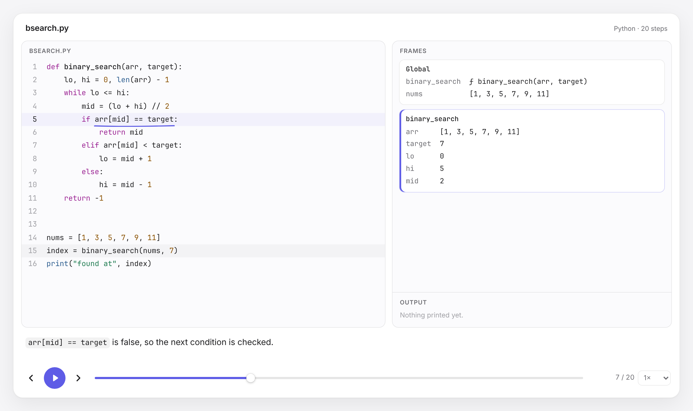

# visset

**Step-by-step visual explanations of code**: the way a good tutor would explain it, with the
exact expression circled by hand and the program's state right beside it.

<picture>
  <source media="(prefers-color-scheme: dark)" srcset="docs/images/player-dark.png">
  
</picture>

```python
import visset
visset.show(binary_search, [1, 3, 5, 7], 5)   # step through one call, like plt.show()
```

visset explains **a function, a snippet, or part of a function**, not a whole codebase. It
shows only the code you point it at, with its real line numbers.

- **Column-precise marks.** Each step circles or underlines the exact code that ran: `i += 1`,
  `arr[mid] == target`, a loop header, a lambda body. Not just the whole line.
- **State after every step.** Call stack frames with their variables, the values that just changed
  highlighted, return values, and the program's output.
- **Plain-English captions.** "`lo <= hi` is true, so the loop body runs." "Call `fib(n=3)`."
  "`arr[3]` becomes `9`." Generated from templates, no AI needed.
- **One self-contained HTML file.** No server, no network. Share it, commit it, embed it.
- **Fast.** Tracing a snippet and writing the HTML takes about a quarter of a second. Python core
  has zero dependencies.
- **Language-neutral by design.** Tracers emit one JSON format ([schema](schema/trace.schema.json));
  one renderer draws it. Adding a language means writing a tracer, not touching the UI.

> **Status: early (milestone 1 of 8).** Python tracing and the step-through player work.
> Heap diagrams with arrows, hand-authored walkthroughs, JavaScript, data-structure views, static
> diagrams, video export, a playground and an optional AI mode are next. See the
> [roadmap](#roadmap).

## Install

visset isn't on PyPI yet. From a clone (needs Python 3.12+, Node 20+, [uv](https://docs.astral.sh/uv/), pnpm):

```bash
pnpm install && pnpm build          # builds the player into the Python package
cd python && uv sync
uv run visset run ../examples/bsearch.py
```

## Use it

### Python

```python
import visset

visset.show(binary_search, [1, 3, 5, 7], 5)        # one live call; args can be any objects
visset.trace_call(binary_search, ([1, 3, 5, 7], 5), lines=(4, 9))   # only lines 4-9 of it

snippet = """
lo, hi = 0, len(arr) - 1
while lo <= hi:
    mid = (lo + hi) // 2
    ...
"""
visset.show(snippet, given={"arr": [1, 3, 5, 7], "target": 5})   # a fragment with inputs

trace = visset.trace(binary_search, [1, 3], 3)     # the trace as a dict (JSON-ready)
visset.to_html(trace, "bsearch.html")
```

A live call runs in your Python process, because real objects can't cross a process boundary. Use
it on code you trust to finish; the step and recursion limits still apply. Source snippets run in
the sandbox.

### Command line

```bash
visset run file.py --fn binary_search --args "[1, 3, 5, 7], 5"   # one function call
visset run file.py --fn Stack.push --args "Stack(), 4"           # a method; args are Python
                                                                  # expressions in the file
visset run file.py --lines 4-9                     # part of a function (the program still runs)
visset run snippet.py --given "arr=[1, 3, 5], target=3"           # a fragment with inputs
visset run file.py                                 # the whole program
visset run file.py -o walkthrough.html             # write HTML instead of opening a browser
visset trace file.py -o file.trace.json            # the raw trace (JSON)
visset render file.trace.json -o out.html          # trace JSON -> HTML
```

With `--fn` the code pane shows only that function, and calls into other functions appear as
single steps ("Call `helper(x=1)`" … "Back in `fn`: `helper` returned `2`"). With `--lines`, steps
outside the range are hidden but still run; output they print is kept.

Limits: `--max-steps` (default 10,000) and `--timeout` (default 5 s). Programs run in a separate
process with CPU and memory limits (see [Safety](#safety)).

In the player: <kbd>←</kbd> <kbd>→</kbd> step, <kbd>Space</kbd> play/pause,
<kbd>Home</kbd> <kbd>End</kbd> jump, <kbd>[</kbd> <kbd>]</kbd> change speed.

### Embed the player

```html
<script src="visset-player.js"></script>
<visset-player src="bsearch.trace.json" theme="auto"></visset-player>
```

`<visset-player>` is a dependency-free web component (about 20 kB gzipped). Set the trace with
`src`, an inline `<script type="application/json">` child, or the `.trace` property. Control it with
`goTo(i)`, `play()`, `pause()` and `setSpeed(x)`, and listen for `stepchange` events. It follows
the system light/dark setting (or `theme="light|dark"`) and honors `prefers-reduced-motion`.

## How it works

```
your code ─▶ tracer (per language) ─▶ trace JSON (one schema) ─▶ <visset-player>
```

The Python tracer uses `sys.monitoring` (3.12+). It parses your code to find the pieces a tutor
would point at (statements, and the *conditions* of `if`/`while`/`for`), then listens for bytecode
instructions only in your file. Instructions that don't start a step are switched off after their
first run, so the tracer costs almost nothing between steps, and library code is never monitored.
The full design and its tradeoffs are in [docs/ARCHITECTURE.md](docs/ARCHITECTURE.md).

## Safety

`visset run` executes the program in a child process with CPU-time, memory, wall-clock and step
limits, an isolated interpreter (`python -I`) and a minimal environment. That protects against
*accidents* (infinite loops, runaway recursion, huge allocations), **not against malicious code**:
the program can still read your files and use the network. Only trace code you would run yourself.
On Windows only the time and step limits apply.

## Known limitations

- **Python 3.12+ only** (`sys.monitoring`).
- **Threads:** only the main thread is recorded.
- **async, generators:** generators work. `async` code runs, but stepping through the event
  loop isn't shown in a meaningful way yet.
- **C extensions** (numpy etc.) are opaque: you see the value's `repr`, not its insides.
- **Big data** is elided: 50 items per container, nesting depth 8, 100 nested calls,
  10,000 steps (all configurable).
- **Object identity:** the tracer holds references to every object it has shown so ids stay
  stable. This can delay `__del__` and weakref callbacks compared with a normal run.

## Roadmap

| | Milestone | Status |
|---|---|---|
| M1 | Python tracer, schema v0.1, step-through player, HTML export; functions, snippets and line ranges | ✅ this release |
| M2 | Heap diagram with reference arrows, recursion stack, code-to-diagram connectors | next |
| M3 | Hand-authored walkthroughs (YAML) | |
| M4 | JavaScript tracer + `npx visset`: same player, second language | |
| M5 | Linked lists, trees, graphs, grids, recursion trees | |
| M6 | Static diagrams (control flow, call graph, classes) via tree-sitter; GIF/MP4 export | |
| M7 | Local web playground | |
| M8 | Optional AI captions (Claude, OpenAI, Ollama) | |

## Contributing

See [CONTRIBUTING.md](CONTRIBUTING.md). MIT licensed.
